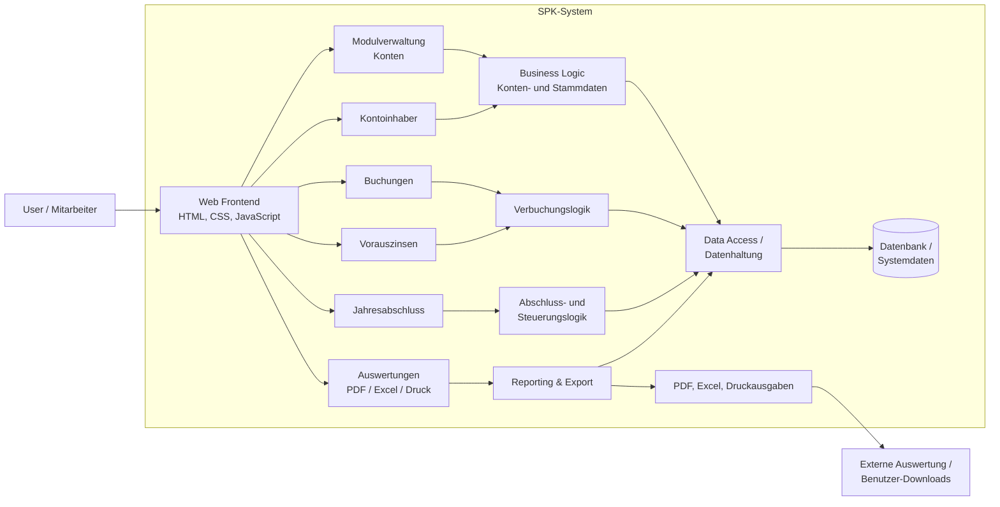

# SPK Architecture Overview

## Overview

This architecture reflects the SPK application structure as represented in the repository:

- A browser-based frontend provides the primary user interaction layer.
- Functional modules cover core accounting workflows such as accounts, account holders, postings, accruals, year-end closing and reporting.
- Business logic coordinates data processing and validation.
- A shared data access layer persists information and supports the reporting and export functions.
- Output artifacts such as PDF and Excel reports are generated for operational and compliance use.

## Main Components

- Frontend: static HTML/CSS/JS pages for navigation and interaction
- Modules: domain-specific features for accounting and financial processing
- Business logic: rules for postings, interest, closing, and financial calculations
- Data layer: access to stored system data and related records
- Reporting: generation of printable and exportable documents
